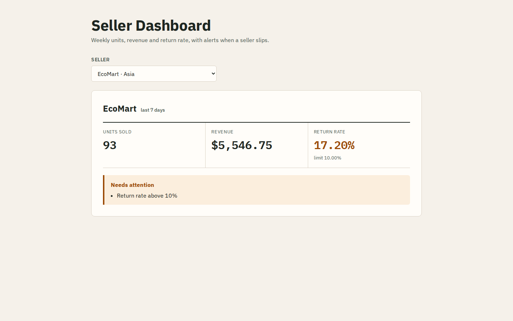
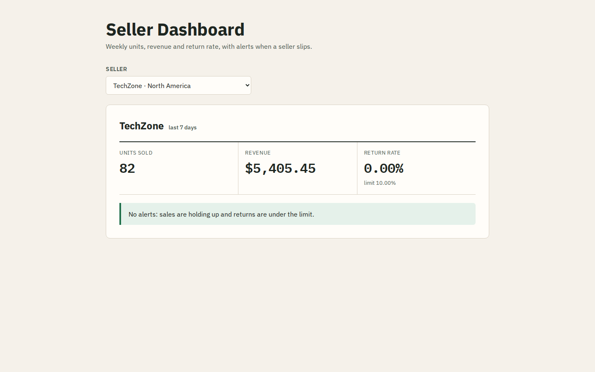
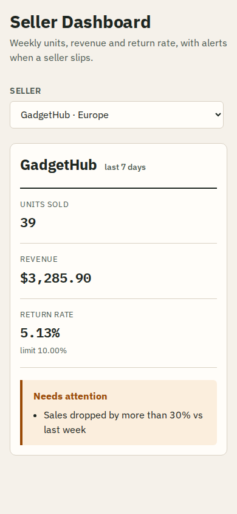
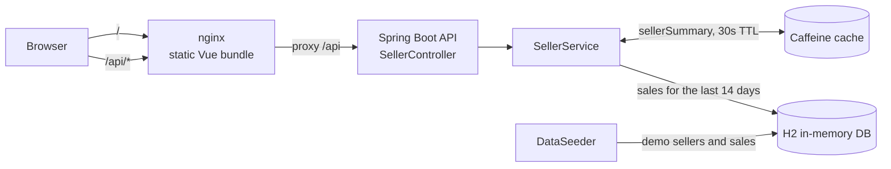

# Seller Dashboard

A small dashboard that tells a marketplace operator, at a glance, how each
seller did over the last seven days and whether anything needs attention.
A Spring Boot API computes weekly units, revenue and return rate from raw
sales rows and raises two alerts; a Vue client shows the figures per seller.



## What it does

- **Weekly figures per seller**: units sold, revenue and return rate for
  the last 7 days.
- **Two alerts**:
  - *Sales dropped by more than 30% vs last week*: this week's revenue is
    below 70% of the previous 7 days' revenue (only when last week had sales).
  - *Return rate above 10%*: returned units / units sold this week.
- **Cached summaries**: each seller's summary is cached in Caffeine for
  30 seconds, so repeated dashboard refreshes don't hit the database.
- **Demo data**: on start-up, three sellers get 30 days of generated sales,
  each set up to show one state: TechZone is healthy, GadgetHub's sales
  collapsed this week and EcoMart has a high return rate. The generator
  uses a fixed seed, so the numbers are the same on every run of the same day.

| All clear | Sales drop (mobile) |
| --- | --- |
|  |  |

## Architecture



In development the Vite dev server takes nginx's place and proxies `/api`
to `localhost:8080`.

## Running it

### Docker Compose (recommended)

Requires Docker with Compose v2.

```bash
cp .env.example .env    # optional: change ports or flags
docker compose up --build
```

- Dashboard: <http://localhost:5173>
- API: <http://localhost:8080/api/sellers>

Stop with `docker compose down`.

### Without Docker

Requires Java 17 (see `backend/.java-version`) and Node 22.22+ (see
`frontend/.nvmrc`). The Maven wrapper downloads Maven 3.9.11 itself.

```bash
# terminal 1
cd backend
./mvnw spring-boot:run          # mvnw.cmd on Windows

# terminal 2
cd frontend
npm ci
npm run dev                     # http://localhost:5173
```

## Configuration

Set these in `.env` for Compose, or as environment variables when running the
jar directly.

| Variable | Default | Purpose |
| --- | --- | --- |
| `API_PORT` / `WEB_PORT` | `8080` / `5173` | Host ports used by Compose |
| `H2_CONSOLE_ENABLED` | `false` | Serve the H2 web console at `/h2-console` (JDBC URL `jdbc:h2:mem:testdb`, user `sa`, empty password) |
| `DEMO_DATA_ENABLED` | `true` | Seed the three demo sellers on start-up |
| `CORS_ALLOWED_ORIGINS` | `http://localhost:5173` | Origins allowed to call `/api` directly from a browser |

## API

Captured from the Compose stack with the demo data:

```console
$ curl -s localhost:8080/api/sellers
[{"id":3,"name":"EcoMart","region":"Asia"},{"id":2,"name":"GadgetHub","region":"Europe"},{"id":1,"name":"TechZone","region":"North America"}]

$ curl -s localhost:8080/api/seller/2/summary
{"totalSales":39,"totalRevenue":3285.9,"returnRate":0.0513,"alerts":["Sales dropped by more than 30% vs last week"]}

$ curl -s localhost:8080/api/seller/3/summary
{"totalSales":93,"totalRevenue":5546.75,"returnRate":0.172,"alerts":["Return rate above 10%"]}

$ curl -si localhost:8080/api/seller/42/summary
HTTP/1.1 404
{"status":404,"message":"Seller 42 not found","error":"Not Found"}

$ curl -si localhost:8080/api/seller/abc/summary
HTTP/1.1 400
{"status":400,"message":"Invalid value for 'id'","error":"Bad Request"}
```

| Endpoint | Returns |
| --- | --- |
| `GET /api/sellers` | Sellers sorted by name: `id`, `name`, `region` |
| `GET /api/seller/{id}/summary` | `totalSales` (units, last 7 days), `totalRevenue` (rounded to cents), `returnRate` (0..1, 4 decimals), `alerts` |

## Tests and lint

```bash
cd backend && ./mvnw verify        # 24 JUnit tests; javac runs with -Xlint:all as errors
cd frontend && npm test            # 18 Vitest tests
cd frontend && npm run lint
```

The backend suite covers the alert thresholds at their exact edges, the
7/14-day window boundaries, return-rate maths and rounding with mocked
repositories; the API (200/404/400, CORS) with MockMvc; the bounded
repository query against H2; the 30-second cache; and the three demo-data
states. The frontend suite covers the API service, the `useDashboard`
composable (including a stale response arriving after the user switched
sellers) and the dashboard component's empty, loading, error, alert and
all-clear states.

## Design notes

- **Rolling weeks.** "This week" is today and the six days before it; "last
  week" is the seven days before that. The comparison never resets on a Monday.
- **Bounded query.** The service loads only the 14 days of sales it needs
  (`findBySellerIdAndDateBetween`) and computes both weeks in one pass.
- **Revenue is gross.** Returned items still count towards revenue, and the
  sales-drop alert compares gross revenue. Returns show up only in the return
  rate.
- **Cache staleness.** A summary can be up to 30 seconds old. That's fine
  for a dashboard and keeps load flat when many people watch the same sellers.
- **Injected clock.** `SellerService` takes a `java.time.Clock`, so tests pin
  "today" and the week boundaries are checked exactly.
- **In-memory database.** H2 is re-created and re-seeded on every start; there
  is no persistent store.

## Project layout

```
backend/    Spring Boot 4 API (controller, service, JPA repositories, seeder)
frontend/   Vue 3 + Vite client (SellerDashboard component, API service)
docs/       Screenshots
```

## License

[MIT](LICENSE)
